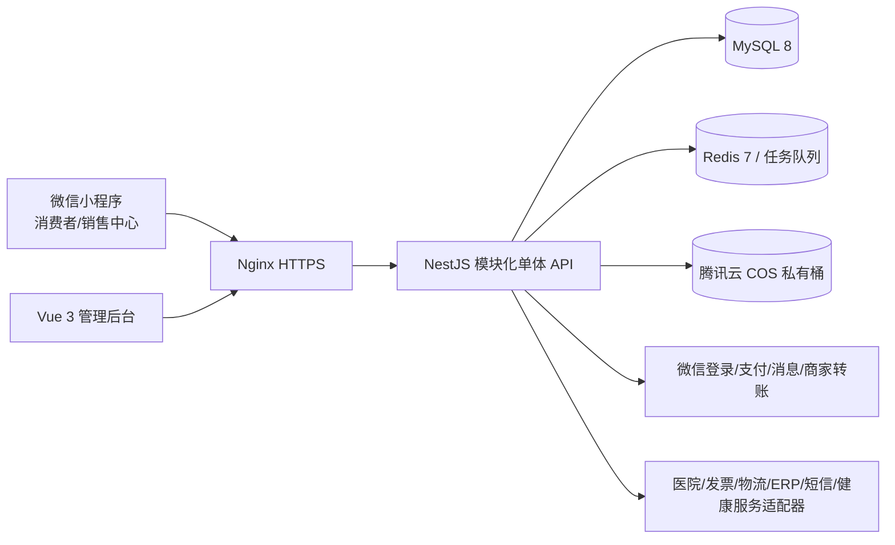

# 九转健康商城微信小程序技术架构建议

## 1. 推荐结论

采用“原生微信小程序 + Vue 3 管理后台 + NestJS 模块化单体服务 + MySQL”的单租户架构。两周首期不做微服务和多租户，把交易、处方、推广和后台放在一个可拆分的服务中；第三方能力通过适配器隔离。

## 2. 技术栈

| 层 | 推荐 | 选择理由 |
|---|---|---|
| 消费者端 | 原生微信小程序 + TypeScript + TDesign 小程序组件 | 直接使用微信登录、支付、订阅消息和文件能力，适老化样式可控，减少框架适配风险 |
| 管理后台 | Vue 3 + TypeScript + Vite + Element Plus + Pinia + Vue Router | 表格、表单、权限、导出和后台 CRUD 开发效率高 |
| 服务端 | Node.js 20 LTS + NestJS + TypeScript | 模块边界、守卫、校验、日志和 OpenAPI 约束清晰，适合后续接入多个外部服务 |
| ORM/数据库 | Prisma + MySQL 8 | 事务、迁移和类型安全；金额、库存、奖励适合关系型事务模型 |
| 缓存/任务 | Redis 7 + BullMQ；没有 Redis 时用 MySQL 任务表兜底 | 处理订单超时、自动收货、周结算、消息重试和分布式锁 |
| 文件存储 | 腾讯云 COS 私有桶 + 短时签名 URL | 处方、病历、发票等文件不放数据库，便于权限控制和生命周期管理 |
| 网关/部署 | Nginx + Docker Compose + 腾讯云 CVM/Lighthouse | 单租户首期成本低，部署简单，后续可迁移到容器平台 |
| API 规范 | REST + OpenAPI；前后端共享 DTO/枚举包 | 便于交付接口文档和第三方对接，不把业务规则放在小程序端 |
| 工程管理 | pnpm workspace + Git + CI | 共享类型、统一 lint/test/build，减少接口字段漂移 |

如果团队已有成熟的 Vue/uni-app 经验，可把消费者端换成 uni-app Vue 3；在本项目只有微信小程序的前提下，原生小程序对支付、订阅消息和文件上传的调试风险更低。

## 3. 系统结构

服务端按业务模块分目录，每个模块包含 controller、application service、domain rule、repository 和 adapter。模块之间通过应用服务或领域事件通信，禁止在 controller 中直接跨模块写表。

## 4. 服务端模块

1. `identity`：微信登录、手机号、用户、就诊人、地址、隐私授权。
2. `catalog`：分类、商品、SKU、图文、上下架、处方标记。
3. `inventory`：批号、有效期、库存流水、锁定/扣减/回滚。
4. `order`：购物车、订单、运费、状态机、售后。
5. `payment`：微信支付下单、回调验签、退款、支付流水和幂等。
6. `prescription`：处方上传、人工录入、审核、有效期、一次性使用。
7. `promotion`：推广码、归属、会员申请、等级和销售中心。
8. `commission`：奖励规则、奖励台账、周结算、扣回、提现。
9. `crm`：客户档案、健康信息、标签、授权和导出。
10. `content`：文章、轮播、推荐和分享配置。
11. `integration`：医院、发票、物流、ERP、短信、健康服务接口；每个接口都有人工 fallback。
12. `admin-audit`：RBAC、操作日志、敏感信息查看日志、导出日志、系统设置。

13. `auth`：微信登录会话、Bearer 签名 token、角色边界和开发演示账号隔离。
14. `operations`：就诊人、地址、售后、发票、结算、客户导出、系统设置和人工任务队列。

## 5. 核心数据表

`users`、`user_consents`、`patients`、`addresses`、`promoters`、`promoter_relations`、`products`、`product_skus`、`inventory_batches`、`inventory_ledgers`、`carts`、`orders`、`order_items`、`payments`、`shipments`、`aftersales`、`prescriptions`、`prescription_files`、`commission_rules`、`commission_ledgers`、`settlements`、`withdrawals`、`articles`、`banners`、`customer_tags`、`audit_logs`、`outbox_jobs`。

建议所有业务表具备 `id`、`created_at`、`updated_at`、`version`；金额字段用整数分；重要业务表保留状态变更记录。处方文件、病历和发票只保存对象存储 key、哈希、文件类型和访问审计，不保存公开 URL。

## 6. 安全与合规设计

- 身份证号、手机号、病史、过敏史等敏感字段应用字段级加密保存；展示时按角色脱敏。
- 管理后台使用 RBAC；销售人员只能访问其归属范围，会员不能访问处方信息；药师只获得审核所需权限。
- 所有敏感查看、导出、下载、处方审核、奖励调整和归属调整写入不可变审计日志。
- 文件使用私有桶和短时签名 URL；拒绝通过日志、错误信息和前端源码泄露敏感数据。
- 健康信息首次填写前展示授权文案；撤回授权、导出和删除策略在隐私政策中明确。
- 支付回调、退款、库存扣减、奖励结算和提现都要验签、幂等和可重试。
- 推广奖励规则上线前完成主体资质、广告宣传、处方药销售和反不正当多级营销的合规审查；技术系统只执行已确认的规则。

## 7. 第三方适配策略

为医院、发票、物流、ERP、短信和健康服务定义统一接口，例如 `PrescriptionProvider`、`InvoiceProvider`、`LogisticsProvider`。真实供应商通过 adapter 实现，默认提供 `ManualProvider`：后台录入处方、填写物流、上传发票和导出健康服务数据。

所有外部调用保存 request id、供应商返回码、重试次数和最终状态；外部服务不可用时，订单和处方主状态不能被重复推进。

开发环境使用人工适配器和内存仓库，生产环境必须切换到经过迁移验证的 MySQL Repository、Redis 任务队列和对象存储适配器；当前 Prisma schema/client 已生成，但真实 Repository 联调仍需要数据库账号。敏感字段使用 AES-256-GCM 字段加密工具，前端和日志只接触脱敏值。

## 8. 两周实施建议

前提是至少 1 名前端、1 名后端、1 名产品/测试，且微信 AppID、支付测试配置、商品资料和奖励清单及时提供。单人开发时应只承诺 P0 的交易和人工处方闭环。

| 时间 | 交付 |
|---|---|
| 第 1 天 | 需求冻结、页面流程、数据字典、权限矩阵、测试账号 |
| 第 2-5 天 | 登录、商品、库存、购物车、订单、微信支付、后台商品/订单 |
| 第 6-8 天 | 就诊人、处方上传/录入/审核、处方订单、发货、消息提醒 |
| 第 9-10 天 | 会员申请、推广归属、销售中心、奖励台账和后台审核 |
| 第 11-12 天 | 周结算、提现申请、内容、售后、导出和审计 |
| 第 13 天 | 接口契约测试、异常状态、权限和敏感数据测试 |
| 第 14 天 | 真机回归、备份恢复、部署、使用说明和源码交付 |

## 9. 验证重点

- 订单超时、自动收货、支付回调重复、退款和库存回滚。
- 处方过期、重复使用、审核拒绝、文件权限和销售人员可见范围。
- 首次推广归属、无来源客户、解绑、会员升级和直接客户奖励计算。
- 周结算、奖励扣回、500 元提现门槛、审核驳回和重复打款保护。
- 身份证号/健康数据脱敏、导出审计、角色越权和签名 URL 过期。
- 大字模式、弱网、上传失败重试、微信支付取消和第三方服务不可用时的人工兜底。

